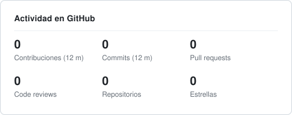
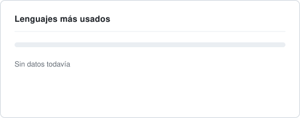
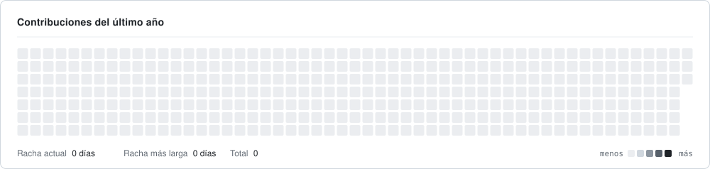

<picture>
  <source media="(prefers-color-scheme: dark)" srcset="./assets/header-dark.svg" />
  <source media="(prefers-color-scheme: light)" srcset="./assets/header-light.svg" />
  
</picture>

  
  
  

Construyo productos donde la inteligencia artificial es parte del núcleo, no un agregado. Lidero equipos técnicos de punta a punta, del modelo de datos a la interfaz, con foco en calidad, velocidad y personas que crecen.

 

### Enfoque

| | |
| :-- | :-- |
| **AI-First** | Integro modelos de lenguaje, agentes y automatización en flujos reales de producto. |
| **Full Stack** | Del diseño de APIs y modelos de datos hasta interfaces rápidas y accesibles. |
| **Liderazgo técnico** | Defino arquitectura, reviso código y acompaño al equipo para que crezca. |
| **Agilidad** | Trabajo con Scrum para entregar valor en iteraciones cortas y medibles. |

### Formación

- **Scrum Foundations**, certificación en marcos ágiles.
- **Ingeniería de Software**, en curso.
- **Liderazgo de equipos**, aprendiendo a guiar con propósito, feedback y confianza.

### Stack

  
  
  
  
  
  
  
  
  
  
  

### Actividad

<picture>
  <source media="(prefers-color-scheme: dark)" srcset="./assets/stats-dark.svg" />
  <source media="(prefers-color-scheme: light)" srcset="./assets/stats-light.svg" />
  
</picture>
<picture>
  <source media="(prefers-color-scheme: dark)" srcset="./assets/languages-dark.svg" />
  <source media="(prefers-color-scheme: light)" srcset="./assets/languages-light.svg" />
  
</picture>

<picture>
  <source media="(prefers-color-scheme: dark)" srcset="./assets/activity-dark.svg" />
  <source media="(prefers-color-scheme: light)" srcset="./assets/activity-light.svg" />
  
</picture>

 
 

> Primero las personas, luego el código. La IA nos ayuda a llegar más lejos; el equipo nos ayuda a llegar juntos.

Las estadísticas se generan en este mismo repositorio con GitHub Actions y se actualizan a diario.
