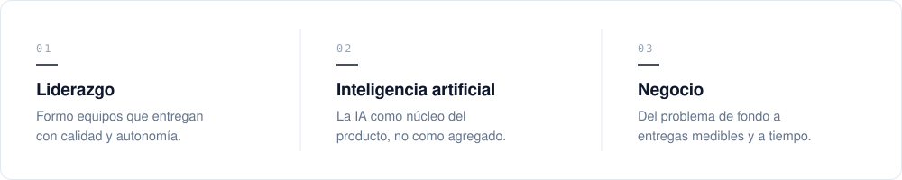

<picture>
  <source media="(prefers-color-scheme: dark)" srcset="./assets/header-dark.svg" />
  <source media="(prefers-color-scheme: light)" srcset="./assets/header-light.svg" />
  
</picture>

<picture>
  <source media="(prefers-color-scheme: dark)" srcset="./assets/pillars-dark.svg" />
  <source media="(prefers-color-scheme: light)" srcset="./assets/pillars-light.svg" />
  
</picture>

 

Resuelvo el problema de fondo, no solo el pedido. Llevo productos digitales y MVP de la idea a producción, con la inteligencia artificial en el centro y un equipo que entrega a tiempo.

**Formación** · Scrum Foundations · Ingeniería de Software (en curso) 
**Herramientas** · TypeScript · React · Next.js · Node.js · Python · PostgreSQL · Docker

 

[luchoweb.dev](https://luchoweb.dev) &nbsp;·&nbsp; [LinkedIn](https://linkedin.com/in/luchowebdev)
